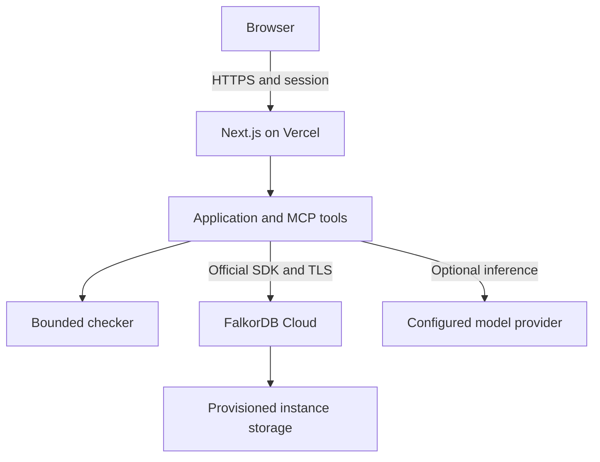

# PARALLAX

### Find the agreement that breaks between teams.

PARALLAX is a graph-backed investigation and coordination workspace for **Graph Hacks Track 01 and Track 02**. It connects customer promises, departmental definitions, implementation rules, events, exact source revisions and accountable owners. Agents use MCP tools to investigate those connections; a deterministic checker produces a reproducible counterexample; people approve the response and supply implementation evidence. FalkorDB preserves the chain for later sessions and other agents.

**The demonstration:** Product promises a fourteen-day trial from first use. Billing schedules a charge fourteen days after email verification. A customer who verifies on day 0 and first uses the workspace on day 7 is charged on day 14, although the promise runs to day 21. Both teams said "activated." The shared obligation exposes the failure: **charging must not begin before promised access expires**.

Source: [ayushmanthehero-lab/Parallax](https://github.com/ayushmanthehero-lab/Parallax). [reports/PROGRESS.md](reports/PROGRESS.md) records deployment and verification evidence. A configured project or successful web build alone does not establish a working hosted database.

**Deployment checkpoint (18 October 2026):** the [public Vercel homepage](https://parallax-graph-sigma.vercel.app) is deployed and returns HTTP 200. The graph-backed API currently returns `503 DATABASE_NOT_CONFIGURED` pending its selected FalkorDB Cloud connection. The complete workflow has been verified locally through the real FalkorDB HTTP gateway; this checkpoint does not claim a Cloud instance is provisioned or the hosted workflow is available yet. Check the release record for subsequent status.

**Selected hosting:** Vercel hosts the website and application API; its official FalkorDB client connects directly to **FalkorDB Cloud**, the database for connected evidence, actions, agent memory and shared state. Railway is an optional self-hosting reference for running the same real engine on compute and disk. It is not required or selected for this hosted route.

## What is implemented

| Capability | Working behavior |
|---|---|
| Investigation | Six scenarios, exact sources, reviewed structured rules, adjustable inputs, disclosed bounds and four verdicts |
| Connected evidence | Actual FalkorDB nodes and relationships, bounded multi-hop traversal, native `shortestPath`, range lookup and full-text source search |
| Agent tools | Six tools registered through the official MCP SDK, internal protocol negotiation, durable run/tool receipts and an optional authenticated external MCP endpoint |
| Coordination | Canonical clarification case, reviewed choice, human approval, owner-assigned tasks, evidence collection and fresh full-domain verification |
| Persistent memory | Episodic findings, semantic decisions, procedural follow-ups, applicability checks and conversation history in the same scoped graph |
| Concurrency | Conditional revisions, payload-bound idempotency, canonical case IDs and persisted agent leases with fencing |
| Workspace separation | Server-selected graph per visitor/company pair; Acme Orbit and Nova Labs intentionally have different trial semantics |
| Interface | Overview, handoffs, cases, tasks, interactive graph, sources/intake, memory, agent activity, verification/audit and settings |
| Verification | Domain, real-engine, MCP, gateway and provider tests; an isolated in-app lab measures concurrency instead of displaying invented benchmarks |
| Hosting design | Next.js on Vercel connects directly to FalkorDB Cloud through the official SDK; a tested self-hosted gateway is also included |

The demonstration uses fictional organizations and sources. Three named agent roles run inside one bounded orchestrator; the application does not claim that three independent background services are deployed. It records human implementation evidence but does not inspect or change a real billing system, send owner messages, or infer that approval completed engineering work.

## Track fit

| Track | Why the graph is necessary | What to show judges |
|---|---|---|
| **01: Agents That Act on Connected Data** | An event producer's meaning must be connected to the rule, source, promise and obligation before an action is justified. MCP exposes graph operations and the checker as bounded tools. | Trace trial evidence; show the 0/7-day counterexample; open a clarification; inspect owner paths and actual tool receipts. |
| **02: Agent Memory and Coordination** | A case, approved interpretation, pending tasks, conversation and past outcome survive the request that created them. Revisions decide when old memory is applicable. | Approve a choice, reload, continue pending work, inspect all three memory kinds, update a source and show rejected stale memory, then switch company. |

## Local setup

### Docker: app, FalkorDB and graph browser

The local Docker recipe runs PARALLAX together with the **official FalkorDB database image and FalkorDB Browser**. Use Docker Desktop, or Docker Engine with Compose v2, and Node.js 24 for the small configuration helper. No Cloud account or model key is required for guided investigations.

```bash
git clone https://github.com/ayushmanthehero-lab/Parallax.git
cd Parallax
node scripts/docker-setup.mjs
docker compose --env-file .env.docker.local up --build --wait
```

The helper generates private local secrets and preserves valid existing settings. It leaves a malformed existing file unchanged and reports what needs repair. Compose installs and builds the application in its container; a host `npm ci` is not needed. `--wait` starts the services in the background and waits for their health checks. If Node.js is not installed, use the [Docker-only setup commands for macOS/Linux or PowerShell](deploy/local/README.md#start).

| Local address | Purpose |
|---|---|
| [http://localhost:3000](http://localhost:3000) | PARALLAX workspace |
| [http://localhost:3002](http://localhost:3002) | Official FalkorDB Browser for inspecting the real graph |
| `127.0.0.1:6379` | Password-protected database connection for local tools |

Open PARALLAX to create the synthetic workspace, then follow the [complete walkthrough](#complete-walkthrough). Check `/api/health`, inspect **Agent activity**, and run **Verification & audit** for a measured result from your own machine. The application connects to the `falkordb` service through the official SDK. The database uses a named volume at `/var/lib/falkordb/data` and AOF with `appendfsync always`. The Compose recipe pins the official `v4.16.3` image by digest.

In FalkorDB Browser, connect to `localhost:6379` with username `default` and the generated local `FALKORDB_PASSWORD` if a login form appears. Select the `parallax_...` graph created by opening the application. This developer browser exposes the real database; the application's agents use their separate scoped MCP tools. Set `FALKORDB_BROWSER_ENABLED=0` in the Docker configuration if you do not need the browser.

```bash
docker compose --env-file .env.docker.local ps
docker compose --env-file .env.docker.local exec app node deploy/local/verify.mjs
```

The verification command checks the running app's health, runs the actual lab against temporary graphs in the configured database and reports its measured result. It cleans up its verification workspace. To stop and remove the containers while retaining the named volume:

```bash
docker compose --env-file .env.docker.local down
```

Run `up --build --wait` again with the same configuration to resume. Keep the same browser hostname, visitor cookie and session secret to return to the same workspace. Removing volumes or resetting a workspace deletes data.

**Execution status:** the Docker recipe is provided for local use; it has not been executed on your computer or in this environment, which has no Docker daemon. The verified real-engine application tests are recorded separately from Docker runtime validation. [The local Docker guide](deploy/local/README.md) contains exact configuration, browser connection, troubleshooting and persistence checks.

### Native Node.js development

Use this alternative when you want to run the web development server and the Lite-packaged engine directly.

Use **Node.js 24** for the documented deployment, or a compatible Node.js version >=22. The official `falkordb@6.8.0` client requires Node >=22. The pinned gateway is Linux x64; its container supplies the native libraries needed by the packaged engine. Local native compatibility depends on the host. [FalkorDB resource notes](docs/FALKORDB_RESOURCES.md) explain the separate client and engine versions.

```bash
git clone https://github.com/ayushmanthehero-lab/Parallax.git
cd Parallax
npm ci
```

Create a private local configuration and generate its signing secret:

```bash
node --input-type=module <<'NODE'
import { readFileSync, writeFileSync } from 'node:fs';
import { randomBytes } from 'node:crypto';
const template = readFileSync('.env.example', 'utf8');
writeFileSync('.env.local', template.replace(
  /^PARALLAX_SESSION_SECRET=.*$/m,
  'PARALLAX_SESSION_SECRET=' + randomBytes(32).toString('hex')
), { mode: 0o600, flag: 'wx' });
NODE
```

The `wx` flag protects an existing configuration from being overwritten. If `.env.local` already exists, retain it and update only the intended settings.

Start the genuine local FalkorDB process in one terminal:

```bash
npm run db
```

Start the web application in another:

```bash
npm run dev
```

Open [http://localhost:3000](http://localhost:3000). The initial workspace is seeded on demand. Keep the database process running. The default development directory is `/tmp/parallax-falkordb`; it is disposable and is not a durable production location. Set `PARALLAX_DB_PATH` when launching the database and set `FALKORDB_SOCKET` to that directory's `redis.sock` to use another location.

If the native engine cannot run on the local OS, use the [gateway container](deploy/gateway/) with a loopback HTTP origin and matching private gateway token. Production gateway connections require HTTPS. The server never silently substitutes a JSON store or a simulated graph.

### Model modes

| Mode | Server configuration | Behavior |
|---|---|---|
| Guided | No provider/key configured, or `PARALLAX_AI_PROVIDER=guided` | An explicitly labeled policy invokes the actual MCP tools and deterministic verifier. It makes no LLM request. |
| Vercel AI Gateway | `PARALLAX_AI_PROVIDER=vercel-gateway`, `AI_GATEWAY_MODEL=openai/gpt-4.1-mini` | The model selects MCP tools through a chat-completions request. Deployed request authentication uses the official `@vercel/oidc` helper. |
| OpenAI-compatible | `PARALLAX_AI_PROVIDER=openai-compatible`, `LLM_API_KEY`, `LLM_MODEL`, optionally `LLM_BASE_URL` | Uses the configured HTTPS model endpoint and records actual provider response metadata. |

AI Gateway can use `AI_GATEWAY_API_KEY` for local development; otherwise it obtains a current Vercel OIDC token inside the request. Authentication, account verification, credits, budgets and provider availability can prevent a model call. Failures are reported explicitly without substituting a guided run and calling it a model result. Selected provider/model settings are configuration, not proof of successful inference. [Official authentication guidance](https://vercel.com/docs/ai-gateway/authentication-and-byok).

Model execution is bounded to 30 seconds, 10 model turns and 12 tool calls. Models cannot choose a graph name, send arbitrary Cypher, change requested verification bounds or approve human decisions through the tool catalog.

## Complete walkthrough

1. In Acme Orbit, open **Handoffs** and **The seven-day trial gap**. Read the obligation, source excerpts and Product/Billing mappings.
2. Run a full-domain investigation. Inspect evidence, memory, checker and coordination receipts in **Agent activity**. The witness has email verification at day 0 and first use at day 7: first charge 14, promised access until 21.
3. Open the clarification. Review **Honor the first-use promise** and approve it. The case becomes `implementation_pending`; Engineering, Billing and QA tasks are created.
4. In **Human tasks**, attach clearly labeled synthetic demonstration evidence to each task. Reload to show that pending work survives the browser request.
5. Return to the case. After all task evidence is recorded, run fresh verification. The adopted mapping is checked over the entire declared finite domain before the case becomes `resolved`.
6. Inspect **Shared memory** and **Sources & intake**. Original counterexamples and sources remain; new source/rule versions link to predecessors. Older scenario-version memories are marked inapplicable.
7. Investigate **Different words, same promise**. Its equivalent comparison is valid within the disclosed finite domain and creates no case. **The missing event owner** returns `UNKNOWN` when reviewed evidence is absent.
8. Switch to **Nova Labs**. Its trial uses an email-verification promise and is compatible within the same declared bounds. Acme's conversation, cases and learned decisions do not cross into Nova's graph.
9. Run **Verification & audit** for a fresh report with real operation counts and latency. The lab uses temporary graphs and retains only its report in the caller's workspace.

## Scenario and verdict catalog

| ID | Shared obligation | Outcome in a fresh Acme graph |
|---|---|---|
| `trial` | First charge is at or after promised trial expiry | `VIOLATED`: charge 14 < promise 21 |
| `beta` | An invitation implies beta eligibility | `VIOLATED`: automation-only workspace is invited but ineligible |
| `threshold` | Every lead promised priority receives it | `VIOLATED`: score 100 passes `>=100` and fails `>100` |
| `bundle` | A granted bundle has every required entitlement | `VIOLATED`: one entitlement satisfies the erroneous OR guard |
| `equivalent` | Admission matches the reviewed quota promise | `VALID_WITHIN_BOUND`: `count<=100` equals `NOT(count>100)` |
| `unknown` | Confirmation requires completed settlement | `UNKNOWN`: reviewed producer/rule evidence is missing |

`VIOLATED` requires a concrete admissible witness. `VALID_WITHIN_BOUND` requires exhaustive checking of the effective finite domain. `NOT_DISPROVED` means the budget ended without a witness. `UNKNOWN` means required semantics, evidence or admissible inputs cannot be established. An explicit input narrows the effective domain; success on one input is not a full-handoff proof.

## API and MCP

Application JSON responses use `{ "ok": true, "data": ... }` or `{ "ok": false, "error": { "code", "message", "details"? } }`. Session cookies establish the workspace; guarded mutations carry current revisions and command identifiers. HTTP 409 reports stale revisions or incompatible command reuse. Exact payload replay reuses the stored command result.

```bash
curl -c /tmp/parallax-cookies.txt http://localhost:3000/api/bootstrap

curl -b /tmp/parallax-cookies.txt \
  -H 'Content-Type: application/json' \
  -H 'Origin: http://localhost:3000' \
  --data '{"scenarioId":"trial","commandId":"readme-trial-001"}' \
  http://localhost:3000/api/investigate
```

The complete endpoint/payload contract is in [docs/ARCHITECTURE.md](docs/ARCHITECTURE.md#9-api-contract). Exact graph queries and read/write boundaries are in [docs/QUERIES.md](docs/QUERIES.md).

The MCP catalog is `find_handoffs`, `trace_evidence`, `recall_memory`, `check_obligation`, `affected_owners` and `open_clarification`. Internal calls use the actual SDK client/server over linked in-memory transports; memory and state live in FalkorDB. External Streamable HTTP at `POST /api/mcp` requires configured `PARALLAX_MCP_TOKEN`, its bearer header **and a valid workspace session cookie**. The transport is stateless; graph state persists. No general-purpose raw-query tool is exposed.

## Verification commands

Run these with the local database available:

```bash
npm test
npm run typecheck
npm run build
npm run verify
```

Standalone scripts use the process environment; unlike Next.js, they do not automatically load `.env.local`. For a custom connection on Node 24, use `node --env-file=.env.local scripts/verify.mjs` or export the required server settings. `npm run verify` writes [reports/verification.json](reports/verification.json) after a real lab run. An absent report is not a passing result.

The in-app lab implements 15 checks: scenario verdicts, multi-hop evidence, native owner paths, canonical cases, stale approvals, command replay, task boundaries, fresh resolution, source history, tenant isolation, lease fencing, read-only enforcement, client continuity, concurrent writes/reads and fixture cleanup. Its workload uses 16 workers with 8 writes each and concurrent reads. Latency is measured for that run and host, not a capacity guarantee.

The integration suite also exercises a separate local engine restart using append-only persistence. That orderly restart test and client reconnection are distinct from host failure, backup restoration or disaster recovery. See [operations](docs/OPERATIONS.md#7-persistence-backups-and-recovery).

## Deploying

The selected hosted design connects the Vercel application directly to FalkorDB Cloud. FalkorDB provides the graph database, and its actual instance settings determine the available storage guarantees:



For FalkorDB Cloud, omit `FALKORDB_HTTP_URL` and `FALKORDB_SOCKET`, then set `FALKORDB_HOST`, `FALKORDB_PORT`, `FALKORDB_USERNAME`, `FALKORDB_PASSWORD` and `FALKORDB_TLS` from the actual provisioned instance. The supported public production path requires a TLS-enabled endpoint and `FALKORDB_TLS=true`. Confirm the selected instance's storage guarantees before setting `FALKORDB_PERSISTENCE=managed`; this flag labels operator-confirmed configuration and does not provision persistence. Cloud features vary by plan. See [direct Cloud setup](docs/OPERATIONS.md#direct-falkordb-cloud-option) and the [official plan features](https://www.falkordb.com/plans/).

In Vercel, import the repository as a Next.js project with Node 24, install `npm ci --include=dev` and build `npm run build`. Set the selected graph connection and a unique `PARALLAX_SESSION_SECRET` as server-side encrypted environment variables. The gateway route uses `FALKORDB_HTTP_URL` and matching `FALKORDB_GATEWAY_TOKEN`; direct Cloud uses the endpoint settings above. Add optional model settings and an external MCP token as needed. Redeploy after changing environment settings. [docs/OPERATIONS.md](docs/OPERATIONS.md) contains ordered setup, health checks, release gates and recovery guidance.

The optional self-hosting reference is [deploy/gateway/Dockerfile](deploy/gateway/Dockerfile), built from repository-root context. On Railway or a compatible host, it runs the real FalkorDB engine behind authenticated HTTPS with a private Unix socket and a persistent `/data` volume. Its AOF uses `appendfsync always`, and a file lock prevents multiple owners of one volume. This tested alternative is retained for reproducibility; it is not needed by the selected direct Cloud connection. Database files do not belong in a Vercel Function.

## Project map

| Path | Responsibility |
|---|---|
| `components/` | Workspace, interactive graph, shared interface primitives |
| `app/api/[...path]/route.ts` | Session-scoped JSON API and external MCP route |
| `lib/domain/` | Scenario fixtures and deterministic bounded checker |
| `lib/server/service.mjs` | Graph queries and revision-guarded transitions |
| `lib/server/seed.mjs` | Typed graph seed, indexes and uniqueness constraint |
| `lib/server/agents.mjs`, `mcp.mjs` | Bounded orchestration, negotiated tools, durable receipts |
| `lib/server/model-provider.mjs` | Guided/direct/Gateway configuration and safe receipts |
| `lib/server/db.mjs`, `http-db.mjs` | Official-client access and authenticated HTTPS transport |
| `deploy/gateway/` | Pinned container, private engine and gateway |
| `compose.yaml`, `deploy/local/` | Local app, official FalkorDB image, graph browser and named-volume setup |
| `scripts/docker-setup.mjs` | Private local Docker configuration without replacing existing secrets |
| `lib/server/verification.mjs`, `tests/` | Measured lab and automated behavioral tests |
| `docs/` | Architecture, queries, operation guide and FalkorDB references |
| `output/pdf/` | Rendered architecture/design brief when generated |

## Boundaries and next production work

This is a complete synthetic hackathon application with deliberate limits. Intake retains source text and proposes an existing human-selected structured mapping; it does not automatically understand arbitrary documents. Verification covers a reviewed finite model. The visitor cookie is a demonstration identity, not organizational SSO or role-based authorization. The access-token gate is an API header gate, not a finished browser login. One persistent graph service is not a highly available cluster. Durable runs support safe retries; an autonomous queue or background scheduler is not included.

For an organizational rollout, add authenticated membership and roles, consented connector ingestion, reviewed mappings for unrestricted sources, rate limiting and retention, backups with restore drills, independent evidence verification, and capacity testing on the selected host.

## Documentation

- [Architecture, workflow, schema, API and design](docs/ARCHITECTURE.md)
- [Actual Cypher query catalog](docs/QUERIES.md)
- [Setup, deployment, monitoring and recovery](docs/OPERATIONS.md)
- [FalkorDB integration references](docs/FALKORDB_RESOURCES.md)
- Generate the separate architecture PDF with `python3 scripts/render-architecture.py` (requires ReportLab; output is intentionally excluded from source control).
