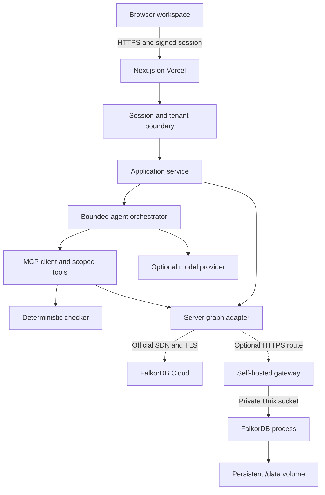
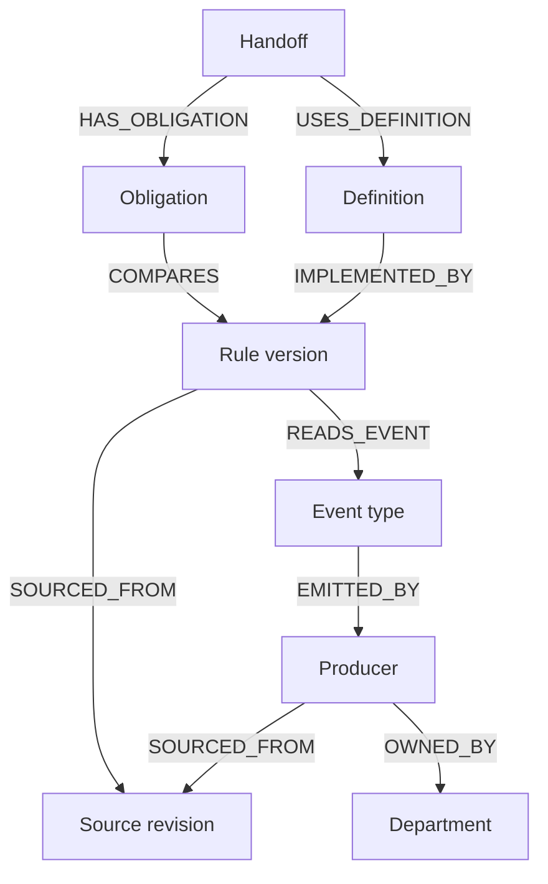
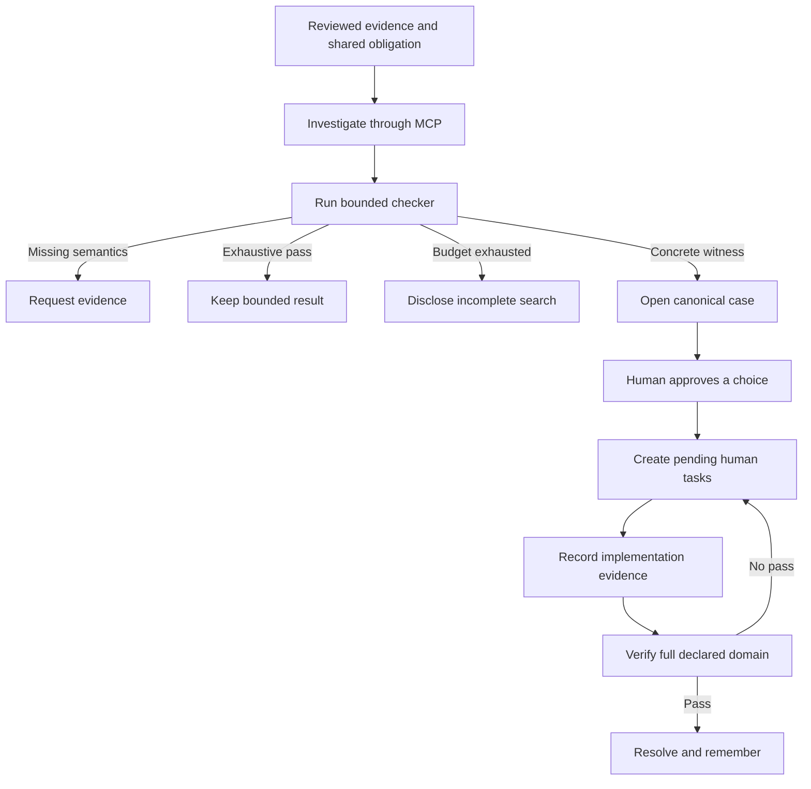

# PARALLAX architecture, workflow and design

**Implementation guide - 18 October 2026**

This document describes the implemented application. Paths refer to this repository. Runtime deployment evidence belongs in [the release record](../reports/PROGRESS.md); architecture diagrams describe responsibilities and connections, not an assertion that every service has been provisioned.

## 1. Product and problem

PARALLAX finds false agreement at organizational handoffs. Two departments can use the same word while making incompatible promises about the same customer. A difference in wording is insufficient: the application requires a reviewed **shared obligation**, a common scope, structured rule mappings and source evidence. It searches for an admissible input that breaks that obligation, opens a human clarification, and remembers the decision and follow-up work.

The user is a product or operations reviewer investigating a release. The primary job is to answer: "Where does our promise fail, which evidence establishes that, who owns the response, and what work is still unfinished?" The application keeps those answers connected rather than reducing them to an untraceable chat summary.

The fictional companies, sources, people and implementation evidence are demonstration data. The three agent names describe roles within one bounded orchestrator. A human reviewer remains responsible for accepting source mappings, selecting a response and supplying implementation evidence. No outbound Slack/email, billing mutation, code deployment or independent verification of a real external system is implemented.

### Worked example: the seven-day trial gap

| Item | Reviewed model |
|---|---|
| Product rule | `promised_access_until = first_use_day + 14` |
| Billing rule | `first_charge_at = email_verified_day + 14` |
| Shared obligation | `first_charge_at >= promised_access_until` |
| Admissibility | `first_use_day >= email_verified_day` |
| Declared domain | Email verification: 0, 7, 14 days; first use: 0, 7, 14, 21 days |
| Counterexample | Email verification 0, first use 7: charge 14, promised access until 21 |
| Proposed repair | Move Billing to the first-use anchor, subject to a human decision and task evidence |

The initial domain has 12 candidate combinations, of which 9 are admissible. The first witness is enough to establish a violation; it does not mean the remaining combinations were checked. After the approved first-use mapping is adopted, resolution requires checking the entire declared domain, including rejecting its inadmissible combinations. Implementation: `lib/domain/scenarios.mjs`, `checker.mjs`.

## 2. Runtime topology

The selected hosted design uses **Vercel and FalkorDB Cloud**. The optional gateway branch is retained as a tested self-hosting reference; it is not a dependency of the Cloud route.

For verification on a user's computer, `compose.yaml` pairs the application with an official FalkorDB image, the bundled graph browser and a named data volume. This is a local execution route for the same application and graph schema; it does not replace or complete the pending hosted connection. See [local Docker operations](OPERATIONS.md#local-docker-workflow). A Docker runtime result is not claimed until the stack is actually run.



| Layer | Implementation | Responsibility |
|---|---|---|
| Interface | Next.js **16.4.2**, React **19.3.1**, TypeScript | Navigation, evidence inspection, forms, graph exploration and explicit result states |
| API | Node runtime, catch-all App Router handler | Session context, origin/access checks, input limits, JSON envelopes and public-field redaction |
| Domain | Standard ES modules | Validated expression language and deterministic finite search |
| Agent protocol | Official MCP SDK **1.32.1** | Tool registration, negotiation, schema validation and transport |
| Model connection | `model-provider.mjs`, `@vercel/oidc@4.0.1` | Explicit guided/direct/Gateway modes, request-time credentials and safe usage receipts |
| Graph client | Official `falkordb@6.8.0` | Parameterized reads/writes and schema helpers |
| Engine packaging | Official `falkordblite@0.3.0`; Linux x64 binary `8.2.3-falkordb.4.16.3` | Actual Redis/FalkorDB process; engine module reports **41603** |
| Self-hosted option | Gateway container, attached Railway volume | One engine owner, AOF persistence, private socket and authenticated HTTP operations |
| Selected Cloud route | Official client to the configured FalkorDB endpoint | TLS connection; actual persistence and recovery depend on provisioned instance settings |

The client, Lite wrapper and database module have different version numbers. This project does not claim that the 6.8 client means a 6.8 engine. The native binary needs libraries supplied by the Node 24 Trixie container. The gateway pins the binary separately because Lite 0.3.0's published optional binary dependency is inconsistent with the available package. See [FalkorDB resource notes](FALKORDB_RESOURCES.md).

**FalkorDB is the database; FalkorDB Cloud is the selected host.** Connected evidence, actions, memory, conversation and shared agent state all live in FalkorDB. Vercel serves the application and connects directly through the official client. The optional self-hosted gateway can run the same real engine on Railway compute with an attached volume; it is not needed by the Cloud route.

The application uses a module-scoped lazy connection. With `FALKORDB_HTTP_URL`, it selects the HTTPS adapter; otherwise it uses the official client with an explicitly configured socket or host. For direct Cloud, omit the HTTP URL and local socket, then provide the actual hostname, port, username, password and TLS setting. A public production connection requires a TLS-enabled instance; its storage guarantees must be confirmed separately before labeling it managed persistence. See [the direct Cloud runbook](OPERATIONS.md#direct-falkordb-cloud-option). The application does not start a production database inside a Vercel Function. For the gateway route, HTTPS terminates at the hosting boundary and the private engine has TCP disabled. Connection credentials are server-only.

## 3. Graph model

Every application entity has the `Entity` label and a specific type label, with a stable `id`. The seed creates an `Entity.id` range index and a UNIQUE node constraint, plus a full-text index on `SourceRevision.text` and `title`. Mandatory-ID constraints are not currently installed; application construction supplies IDs. Schema setup is idempotent.

Complex expressions, bounds, trace arrays and payloads are JSON properties of their own typed nodes. The application does not store the complete workspace as one JSON node. Distinct sources, rules, cases, tasks and memories remain traversable. The shared utility packs structured properties into JSON and hydrates them at the service boundary.

### Evidence schema



The trial graph contains real paths from the billing rule to `ACCOUNT_ACTIVATED`, the Identity service and Engineering source evidence. Source provenance and ownership are part of the investigation, not decorative connections. Current rules are selected using `current=true`; old versions and their relationships stay available for history.

### Implemented node and relationship inventory

| Nodes | Key stored fields | Actual principal relationships |
|---|---|---|
| Workspace, Launch | Tenant, name/title, revision, state, seed version | Workspace `HAS_LAUNCH` Launch; Launch `HAS_HANDOFF` Handoff and `DELIVERS` Promise |
| Department, Person | Department name/color; person name, role, departmentId | Workspace `HAS_DEPARTMENT` Department; Person `MEMBER_OF` Department |
| Handoff, Promise, Obligation | Scenario ID, scope, state, revision, finite domain; promise text; reviewed obligation expression | Handoff `FROM` / `TO` Department, `ASSIGNED_TO` Person, `HAS_OBLIGATION` Obligation; Promise `GOVERNED_BY` Obligation |
| Definition, Rule | Meaning, scope, logical rule ID, expression, sourceId, revision, current/reviewed flags | Handoff `USES_DEFINITION` Definition; Definition `IMPLEMENTED_BY` Rule; Obligation `COMPARES` Rule; Rule `OWNED_BY` Department |
| Source, SourceRevision | Exact text, source type, department, version, content hash, reviewed flag | Source `HAS_REVISION` SourceRevision and `OWNED_BY` Department; Rule/Definition/Producer `SOURCED_FROM` SourceRevision |
| EventType, Producer | Event meaning, producerId; producer name, reviewed flag, sourceId | Rule `READS_EVENT` EventType; EventType `EMITTED_BY` Producer; Producer `OWNED_BY` Department |
| Interpretation | Proposed expression/text, status, reviewer, expected scenario/source/rule versions | Intake Interpretation `INTERPRETS` Source and `APPLIES_TO` Handoff; SourceRevision `SUPPORTS` Interpretation; accepted Interpretation `PROPOSES_CHANGE` Rule |
| VerificationRun, Counterexample | Verdict, checker version, completeness, counts, bound/version snapshots, witness trace | VerificationRun `CHECKED` Handoff, `USED_RULE` Rule, `USED_SOURCE` SourceRevision and `FOUND` Counterexample; Counterexample `VIOLATES` Handoff |
| Case, Decision | Status, own revision, scenario revision, verification/decision IDs; approved choice, note, rule updates | Case `ABOUT` Handoff, `BASED_ON` VerificationRun, `ASSIGNED_TO` Person and `HAS_DECISION` Decision; Decision `RESOLVES` Case |
| Task | Owner/department, state, evidence, revision, caseId, decisionId | Case `HAS_TASK` Task; Task `IMPLEMENTS` Decision and `ASSIGNED_TO` Person |
| Memory | Kind, body, scope, scenario revision, outcome, case/decision IDs | Memory `LEARNED_FROM` Case or Decision and `APPLIES_TO` Handoff |
| Agent, AgentRun, ToolCall | Role; run mode/status, checkpoint, lease/fence, result; actual tool arguments/result/duration | Workspace `HAS_AGENT` Agent; AgentRun `USED_TOOL` ToolCall |
| Session, Message | Tenant, role, body, scenarioId and timestamps | Workspace `HAS_SESSION` Session; Session `HAS_MESSAGE` Message; intake Message `REFERS_TO` Interpretation |
| Command, AuditEvent | Payload hash, saved result; action, actor, time, details | Command `CAUSED` Decision/Task/VerificationRun/Interpretation; AuditEvent `AFFECTED` relevant entity |
| VerificationReport | Lab status, checks, measured concurrency and timestamps | Stored as an independent typed report node |

Version changes add `Rule-[:SUPERSEDES]->Rule` and `SourceRevision-[:SUPERSEDES]->SourceRevision`. Successful resolution adds `Case-[:VERIFIED_BY]->VerificationRun` and `Decision-[:ADOPTED]->Rule`. The existing `RESOLVES` edge describes a decision's intended relation to a case; **case status and fresh verification**, not that edge alone, establish resolution. Agents do not have fabricated `READ_MEMORY` or `PERFORMED` edges: role ownership and actual operations are recorded on ToolCall properties and run receipts.

New rule versions retain department ownership and reconstruct `READS_EVENT` links from the adopted expression and existing modeled input/event bindings, including named-rule dependencies. Links are scoped to events in the actual scenario. Missing producers remain missing; source text does not invent a new event contract. Historical rule versions keep their existing provenance. These guarded version-creation paths do not migrate or backfill existing visitor graphs.

## 4. Bounded verification

The checker executes a closed JSON expression language:

```json
{
  "op": "add",
  "args": [
    { "op": "var", "name": "first_use_day" },
    { "op": "const", "value": 14 }
  ]
}
```

Supported operators are `add`, `sub`, `eq`, `neq`, `gt`, `gte`, `lt`, `lte`, `and`, `or`, `not` and `in`, plus constant and variable nodes. Expressions are evaluated without dynamic code execution. Numeric inputs require units and finite values. Rules are ordered by their output dependencies; cycles, undefined variables, unsupported syntax and unreviewed evidence prevent a confident verdict.

| Verdict | Necessary condition | User-facing implication |
|---|---|---|
| `VIOLATED` | One admissible assignment evaluates the reviewed obligation to false | A reproducible case may be opened against that exact current revision |
| `VALID_WITHIN_BOUND` | Every admissible assignment in the effective finite domain was evaluated; at least one exists; none violates | Valid for the disclosed domain and mappings |
| `NOT_DISPROVED` | Candidate budget ended without a witness | Remaining assignments were not checked |
| `UNKNOWN` | Missing/unreviewed evidence, unsupported semantics or no admissible assignment | Request or review evidence; do not invent a mismatch |

The domain module caps AST depth at 24, AST nodes at 512, inputs at 16, rules at 32, values per input at 1,024 and declared candidates at 100,000. Service verification uses a 5,000-candidate budget. Candidate examination includes excluded inputs. Runs expose examined/evaluated/excluded counts, declared and effective domains, checker version, source/rule snapshots, completeness and witness evaluation trace.

A submitted input must belong to its declared domain. It narrows only the named variables. The orchestrator enforces that a model passes exactly the user's requested input bound, or omits inputs for a full-domain request. A valid narrowed run does not upgrade the overall handoff to valid. Case resolution always omits input overrides.

## 5. Investigation and human workflow



A case is canonical per scenario revision, so concurrent coordinators converge on one case. Opening requires a persisted `VIOLATED` result with a witness for the same current scenario. Relevant people come from the graph; owner routing does not send notifications.

The normal persisted state sequence is `open` -> `implementation_pending` -> `verification_pending` -> `resolved`. The UI can preview the human decision without claiming a separate durable approval has occurred. Approval writes the decision, all tasks, two memory records and an audit event together. Evidence is required to complete each task. The final task advances the case to verification pending.

Resolution constructs the approved candidate mappings, records the submitted synthetic implementation evidence into a new source revision, runs the full bounded checker, and adopts versions only when the result is complete and valid within the bound. Historical source text, original counterexamples and earlier verification runs remain stored. This verifies the modeled mapping; it does not establish that an outside production system changed.

### Source intake and change review

Intake stores text, a conversation message and a proposed structured mapping. A user may select an available reviewed mapping option; otherwise the current mapping is retained as a proposal. Arbitrary free text is never automatically promoted to executable truth. The review modal makes that responsibility explicit.

Accepting a current proposal creates a new SourceRevision and Rule, links predecessors, advances the Handoff revision and returns it to `unexamined`. A stale proposal is rejected. Previous cases and memories remain inspectable but lose current applicability. Rejecting a proposal preserves its review history without changing the current rule.

## 6. Agents and MCP tools

| Tool | Role | Graph action or result |
|---|---|---|
| `find_handoffs` | Iris, investigator | Read connected handoffs and shared obligations |
| `trace_evidence` | Iris | Traverse approved relation types to depth 6, at most 100 paths; return exact current rules and sources |
| `recall_memory` | Iris | Read accepted and rejected scenario memory in the current tenant |
| `check_obligation` | Cato, verifier | Evaluate the model and persist verification, witness and audit |
| `affected_owners` | Vega, coordinator | Execute native shortestPath to graph-linked people, bounded to 6 hops |
| `open_clarification` | Vega | Create or join the canonical case for a persisted current violation |

Tool arguments are strict domain schemas. They do not accept tenant, graph, credentials, arbitrary Cypher or a human approval action. Internal MCP uses the official SDK Client, McpServer and linked InMemoryTransport pair. This is real protocol negotiation and validation; "in-memory transport" does not mean in-memory application storage. External MCP uses the SDK's stateless WebStandardStreamableHTTPServerTransport and records standalone calls in FalkorDB.

Guided mode invokes the same tools through a disclosed policy. Model-directed investigation obtains the catalog and lets the configured provider select tools under ordering, scope, evidence and bound checks. It has a 30-second overall deadline, at most 10 model turns and 12 calls, with bounded provider responses. Incomplete or failed work retains receipts and is not labeled a complete investigation. Gateway authentication is resolved inside the active request with a bounded wait; credentials are never stored in receipts.

The chat drawer preserves both sides of the conversation. Explicit investigation requests invoke the configured investigation mode. Ordinary lookup questions use read-only guided MCP retrieval even if a model provider is configured. Chat cannot approve decisions or complete tasks.

## 7. Memory and shared coordination

| Memory kind | Creation | Interpretation on recall |
|---|---|---|
| Episodic | A confirmed violation opens a clarification | What happened, with its witness and scenario revision |
| Semantic | Seeded reviewed scope; human approval; successfully verified adopted mapping | What was reviewed or decided, including whether implementation is still pending |
| Procedural | Curated baseline; approval-generated follow-up procedure | How to investigate or resume human tasks under the recorded conditions |

All agent roles access the same graph-backed records. Applicable scenario memory must match the selected scenario and current Handoff revision; graph selection supplies the tenant/visitor boundary. A workspace procedure without a scenario revision remains available within that tenant graph. Revision checks are deliberately coarse: any accepted source change advances the scenario and invalidates older scenario memories. The current implementation does not perform vector similarity retrieval, semantic entailment or field-by-field source diff inference to decide applicability.

Pending cases, decisions, tasks, run checkpoints and conversation survive browser reloads and application client reconnection because they are stored in FalkorDB. A signed cookie has a seven-day lifetime. Clearing/expiring it or rotating its signing secret creates a different graph context; it is not account-based cross-device recovery.

## 8. Concurrency and mutation contract

Human mutations use `commandId`, a hash of the operation and payload, and `expectedRevision`. The service checks replay, then performs the revision/state conditions and related writes in one graph query. Exact replay returns the saved result; reuse with a different payload returns `COMMAND_REUSED`. A zero-row conditional mutation is reconciled against the stored command and current item before returning `REVISION_CONFLICT`.

FalkorDB documents per-graph write serialization and single-query atomicity. PARALLAX relies on one guarded graph statement for each state transition and tests the behavior on its actual engine. It does not claim multi-query application rollback. Application `revision` fields are unrelated to the engine's schema-cache `GRAPH.QUERY version` argument. [Official concurrency reference](https://docs.falkordb.com/design/concurrency).

Agent runs store a 65-second lease, a private token and an increasing fence. A retry may reclaim a failed or expired run; the older worker cannot commit tool receipts, verification/case mutations or final completion with its old fence. Completed command replay returns the durable result. Checkpoints describe persisted progress; no autonomous retry queue or background scheduler is included. A reclaimed run may repeat safe reads while resuming the orchestration under a new lease.

Intake and individual chat messages append new records and do not implement the same exact-once command contract as decision/task/source-review transitions. Network retries of those append operations may add another message/proposal. This boundary is documented rather than claiming global exactly-once behavior.

## 9. API contract

Routes live in `app/api/[...path]/route.ts`. Dynamic route parameters are awaited per the installed Next.js documentation. API responses are private/no-store JSON envelopes. The JSON request-text limit is 32,768 characters; individual domain fields have smaller validation limits.

| Method and endpoint | Payload or behavior |
|---|---|
| GET `/api/bootstrap` | Session-scoped workspace, scenarios, owners, counts, connection and agent configuration |
| POST `/api/workspace` | `{tenant:"acme"|"nova", reset?:true}`; selection or reset of only this visitor/tenant graph |
| GET `/api/graph?scenarioId=&q=` | Typed nodes/edges; optional scenario filter and full-text source matches |
| GET `/api/scenarios/:id` | Current sources/rules, obligation, bounds, owners, runs, cases and interpretations |
| POST `/api/investigate` | `{scenarioId, inputs?, commandId?}`; use a stable command ID for a retry |
| GET `/api/runs` | Persisted run status and actual tool receipts |
| GET `/api/cases`, `/api/cases/:id` | Case list or full choices, tasks, evidence, decisions and history |
| POST `/api/cases/:id/decision` | `{choice, note?, expectedRevision, commandId}`; creates pending tasks |
| POST `/api/tasks/:id/complete` | `{evidence, expectedRevision, commandId}`; evidence is 8-8,000 characters |
| POST `/api/cases/:id/verify` | `{expectedRevision, commandId}`; requires all task evidence and a full-domain pass |
| GET `/api/tasks` | Human tasks and recorded evidence |
| GET `/api/sources` | Exact source revisions and proposed/reviewed interpretations |
| POST `/api/intake` | `{text, scenarioId, departmentId, choiceId?}`; text is 8-16,000 characters |
| POST `/api/interpretations/:id/review` | `{action:"accept"|"reject", expectedRevision, commandId}`; original fixture reviews cannot be overwritten |
| GET `/api/memory` | All three memory kinds with current applicability reasons |
| GET `/api/chat`; POST `/api/chat` | Persisted history; `{message, scenarioId?, commandId?}` for lookup/investigation |
| GET `/api/audit` | Ordered events and transition details |
| GET `/api/health` | Actual graph health, provider configuration and external MCP configuration flag |
| GET / POST `/api/verification` | Last actual report / run isolated verification fixtures |
| POST `/api/mcp` | External MCP protocol; configured bearer token plus current signed workspace cookie |

A successful envelope is `{ok:true,data:...}`. Errors are `{ok:false,error:{code,message,details?}}`. Normal application identifiers and evidence remain visible; `leaseToken`, `payloadHash`, `graphName` and `visitor` are redacted recursively. The route exports DELETE for protocol dispatch, but general application DELETE operations are not supported. External MCP accepts POST.

## 10. Interface design

The interface is a working investigation console: warm off-white canvas, charcoal navigation, restrained coral actions, teal confirmed evidence, amber pending/unknown states and thin neutral dividers. The PARALLAX mark uses two offset frames. Color reinforces text labels rather than carrying verdict meaning alone.

Navigation follows a reviewer's work: Overview -> Handoffs -> Clarification cases -> Human tasks; Knowledge graph, Sources & intake, Shared memory and Agent activity expose the evidence; Verification & audit and Architecture & settings expose confidence and configuration. The graph supports node details, pan, zoom, search and scenario filtering. Source text and structured rules remain readable as cards outside the graph.

Requests have explicit loading, empty, unavailable and error states. Results are keyed to scenario and tenant context so an earlier company's response is not displayed under a new selection. Stale case/verification information is presented as history. Approving a decision displays pending implementation tasks; model/provider settings do not fabricate successful calls. Mobile navigation collapses; controls use labels, keyboard focus and a focus-managed modal. Reduced-motion preferences are respected.

## 11. Security and trust boundaries

The signed HttpOnly, SameSite=Lax session cookie derives a private visitor/company graph on the server. Secure is set in Vercel. Only `acme` and `nova` are accepted. Browser or MCP tool input cannot choose a graph key. This is demonstration isolation, not organizational authorization. An optional access-token header gates API access but does not provide user roles or a browser login.

The gateway requires a 32-1,024-byte private token without whitespace, uses constant-time token comparison, validates graph names and operation fields, limits JSON bodies to 2 MiB and query text to 256 KiB, and caps query timeouts at 15 seconds. Only its service credential holder can submit graph operations. That credential is privileged across accepted graph names; the Next.js application enforces visitor/tenant access before reaching the gateway. HTTPS is mandatory outside loopback, redirects are rejected, and credentials never enter the client bundle.

Untrusted source text is data. It is neither executable code nor authority to change tool policy. All application Cypher values are parameterized and query templates are server-owned. Read-only paths use GRAPH.RO_QUERY. Error responses redact infrastructure details in production. Audit history is append-oriented under the application API, not a cryptographically tamper-evident compliance ledger. Authorized workspace reset deletes that visitor's synthetic graph.

## 12. Verification and operating limits

The application includes behavioral tests for expression validity, bounds, injection-like input, false-positive controls, genuine graph traversal, canonical cases, revision conflicts, replay, tenant separation, source history, full human lifecycle, leases, MCP negotiation, model bound enforcement, provider errors and the HTTP gateway.

The in-app lab performs 15 isolated checks. Sixteen workers attempt eight atomic writes each alongside reads; it measures acknowledged receipts, stored increments, p50/p95/max latency, duplicate cases and rejected stale approvals. The caller's sources, decisions, tasks and messages are not fixture data. Only the resulting measured report is retained. See `lib/server/verification.mjs` and [operations](OPERATIONS.md).

A client reconnect proves client continuity. A local orderly engine restart with AOF proves that tested restart path. Neither establishes recovery from corrupted storage, host loss or backup restoration. Actual host storage configuration, a hosted restart and a restore drill are separate operating checks. Current limits include one graph service, finite curated scenarios, no external connector ingestion, no production SSO/RBAC, no autonomous queue, and no automatic independent validation of submitted implementation evidence.

## 13. FalkorDB resources used and deliberately optional

| Resource | Role in this project |
|---|---|
| Official TypeScript client and Lite | Actual database operations and reproducible local/hosted engine packaging |
| Cypher and GRAPH.RO_QUERY | Parameterized typed reads, safe read paths and atomic conditional writes |
| Variable-length traversal and shortestPath | Explainable evidence paths and owner routing |
| Range/full-text indexes and uniqueness | Stable entity lookup, source search and canonical identity support |
| AOF and engine status commands | Persistent write log and truthful health/persistence reporting |
| Official MCP specification/SDK | Application-specific tools with scoped authority and durable receipts |
| FalkorDB MCP servers | Referenced extension examples; their raw-query tools are not embedded into this public demo |
| GraphRAG SDK, vector search, LangChain | Optional for a later unrestricted source-retrieval pipeline; not claimed as implemented |
| Cloud and self-hosting guidance | Used to select a host with real persistence rather than equating connectivity with durability |

Using every available SDK would add redundant runtimes without strengthening this finite-evidence workflow. The implemented integration uses the graph features needed to justify actions and coordinate remembered work; optional resources are linked for a clear next extension. [Full sponsor resource reference](FALKORDB_RESOURCES.md).

## References

Implementation sources: `lib/domain/scenarios.mjs`, `checker.mjs`; `lib/server/seed.mjs`, `service.mjs`, `agents.mjs`, `mcp.mjs`, `model-provider.mjs`, `verification.mjs`, `session.mjs`, `db.mjs`, `http-db.mjs`; `deploy/gateway/`; `components/`; `tests/`.

Primary platform references, reviewed 18 October 2026:

- [FalkorDB TypeScript client](https://github.com/FalkorDB/falkordb-ts) and [Lite](https://github.com/FalkorDB/falkordblite-ts)
- [GRAPH.QUERY](https://docs.falkordb.com/commands/graph.query), [GRAPH.RO_QUERY](https://docs.falkordb.com/commands/graph.ro_query)
- [Cypher functions and shortestPath](https://docs.falkordb.com/cypher/functions), [full-text indexes](https://docs.falkordb.com/cypher/indexing/fulltext-index), [concurrency](https://docs.falkordb.com/design/concurrency)
- [Model Context Protocol SDKs](https://modelcontextprotocol.io/docs/sdk)
- [Vercel Node runtime](https://vercel.com/docs/functions/runtimes/node-js), [AI Gateway authentication](https://vercel.com/docs/ai-gateway/authentication-and-byok)
- [Railway volumes](https://docs.railway.com/volumes)
- [Graph Hacks resources](https://www.wemakedevs.org/hackathons/falkordb/resources)
